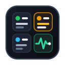
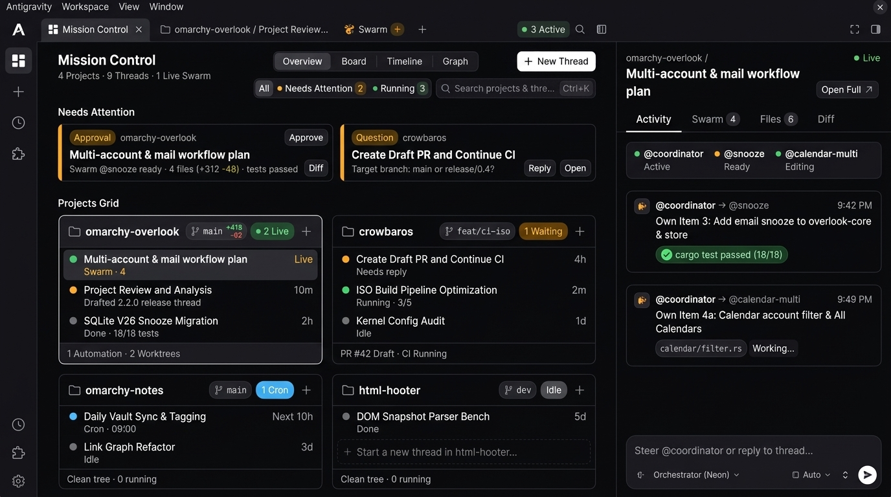

<div align="center">



# Mission Control

**A cross-project dashboard plugin and auxiliary-pane web UI sidecar for Antigravity.**

Monitor every workspace, triage approvals, live agent questions, and unseen completed threads, inspect Swarm boards and Git telemetry, and steer threads without leaving your current context.

[](LICENSE)
[](https://nodejs.org/)
[](#architecture)
[](#quick-start)

[Features](#features) · [Quick Start](#quick-start) · [Standalone Preview](#standalone-preview) · [Architecture](#architecture) · [HTTP API](#sidecar-http-api) · [Development](#development--testing) · [License](#license)

</div>

<p align="center">
  
</p>

---

## Features

- **Cross-Project "Needs Attention" Triage Strip**
  Surfaces high-priority states across all Antigravity workspaces in one horizontal triage bar:
  - **Approval** (`Approve` / `Diff`) — pending command or file approvals blocking execution.
  - **Error / Quota** — surfaced run failures and rate/quota stops.
  - **Question** (`Reply` / `Open`) — active pending `ask_question` tool calls waiting on user input (without false positives on normal finished answers).
  - **Stuck** — stalled active runs flagged for attention.
  - **Done (Unseen)** (`Open` / `Dismiss`) — emerald-badged cards that bubble newly finished threads to the top until you open or dismiss them. Seen timestamps persist to `seen_threads.json` under `ANTIGRAVITY_EXECUTABLE_DATA_DIR`, and the currently open `conversationId` is auto-marked seen.

- **Multi-Project 2×2 Workspace Matrix**
  Collapses navigation clutter into a compact icon rail and displays each project in a telemetry-rich card:
  - Active Git branch, staged/unstaged working-tree line diffs (`+added -removed`), and linked `git worktree` counts.
  - Optional GitHub CLI (`gh`) PR & CI check status.
  - Live thread status counts, active **Swarm** roster badges, and scheduled **Cron** automations (`HH:MM` + next-run countdown).

- **Live Right-Hand Thread Peek & Quick-Reply Inspector**
  Click any thread card or triage item to open the inspector pane alongside the project grid:
  - Switch across **Activity** (including pending approval and `ask_question` cards even on Swarm threads), **Swarm** (member states & board messages), **Files**, and **Diff** tabs.
  - Send follow-up instructions or approve/reject actions directly from the docked quick-reply composer (dispatched via `agentapi`).

- **Dedicated Views, Fast Filtering & Command Palette**
  - Switch between **Overview**, **Board** (4-column Kanban), **Timeline** (chronological feed), **Graph** (interactive SVG workspace/thread/swarm topology), and full-width **Usage** (live Antigravity model quota pools for Gemini/Claude/GPT, reset countdowns, and AI credit balances).
  - Filter instantly by `All`, `Needs Attention`, or `Running`, search across workspaces, threads, and models, jump anywhere with `Ctrl+K` / `Cmd+K`, toggle Live/Demo datasets, or collapse cleanly into a responsive drawer in narrow aux panes.

- **Zero Runtime Dependencies & Aux-Pane Native**
  Pure Node.js ESM backend with zero third-party `npm` dependencies, paired with a self-contained classic IIFE frontend bundle (`public/app.js` compiled via `build_client.mjs`) so Antigravity's authenticated `sidecar_sdk` iframe loads reliably without ES-module CORS preflights and inherits host dark/light CSS variables automatically.

---

## Quick Start

### 1. Install the Plugin

Clone this repository and run the idempotent installer to link it into `~/.gemini/config/plugins/mission-control`:

```bash
git clone https://github.com/jasona/mission-control.git
cd mission-control
./install.sh
```

Installer options:

```bash
./install.sh              # Symlink into ~/.gemini/config/plugins/mission-control (default)
./install.sh --copy       # Copy plugin files instead of symlinking
./install.sh --force      # Back up an existing directory or replace a mismatched symlink
./install.sh --uninstall  # Remove ~/.gemini/config/plugins/mission-control
```

> [!NOTE]
> Node.js 20+ must be available in your `PATH`. Set `GEMINI_PLUGINS_DIR` to override the default `~/.gemini/config/plugins` install location.

### 2. Enable & Open in Antigravity

1. Open **Customizations → Plugins → Mission Control** (`customization://mission-control`) and ensure **Mission Control** is enabled.
2. Open the auxiliary pane view via `[Open Mission Control](sidecar://mission-control/mission_control/)`, or ask an Antigravity agent to open Mission Control.

---

## Standalone Preview

You can preview Mission Control in any browser outside Antigravity using its built-in standalone HTTP server:

```bash
# Demo mode with interactive sample workspaces, swarms, crons, and triage items
node sidecars/mission_control/main.mjs --standalone --demo --port 4321
```

Then open **http://127.0.0.1:4321/** (add `?demo=1` if you started without `--demo`).

To inspect your real local Antigravity workspaces, transcripts, swarms, Git repos, and scheduled cron jobs instead of sample data, omit `--demo`:

```bash
node sidecars/mission_control/main.mjs --standalone --port 4321
```

Supported CLI flags and environment variables:

| Option | Env Fallback | Default | Description |
| --- | --- | --- | --- |
| `--standalone` | `SIDECAR_STANDALONE=1` | `false` | Forces loopback `node:http` server instead of `sidecar_sdk`. |
| `--demo` | `SIDECAR_DEMO=1` | `false` | Serves the stateful demo dataset by default. |
| `--port <n>` | `PORT` | `4321` | Port to bind on `127.0.0.1`. |

---

## Architecture

For the original design goals and UI breakdown, see [docs/mission_control_plugin.md](docs/mission_control_plugin.md).

```text
mission-control/
├── LICENSE                         # MIT License
├── .gitignore
├── plugin.json                     # Antigravity plugin manifest
├── install.sh                      # Idempotent symlink/copy/uninstall installer
├── README.md
├── assets/
│   └── logo.svg                    # High-contrast 128x128 plugin icon
├── docs/
│   ├── mission_control_plugin.md   # Design spec
│   └── mission_control_plugin.png  # Hero UI creative
├── rules/
│   └── AGENTS.md                   # Always-on rule for Mission Control entry points
├── skills/
│   └── mission-control/
│       └── SKILL.md                # Skill guiding agents on opening & using the panel
└── sidecars/
    └── mission_control/
        ├── package.json            # Zero-dependency Node ESM manifest
        ├── sidecar.json            # Aux-pane sidecar manifest
        ├── main.mjs                # SidecarApp + standalone HTTP server & preload stub
        ├── build_client.mjs        # Zero-dep ESM -> classic IIFE frontend bundler
        ├── lib/
        │   ├── discovery.mjs       # Projects, brains, plugins & sidecars discovery
        │   ├── transcript.mjs      # transcript.jsonl parser, pending prompt & cache
        │   ├── swarm.mjs           # Swarm members, board messages & worker dedupe
        │   ├── git.mjs             # Async git branch, diff, worktree & optional gh PR telemetry
        │   ├── cron.mjs            # Scheduled cron parser & next-run computation
        │   ├── seen.mjs            # Persistent seen-thread tracking (seen_threads.json)
        │   ├── aggregator.mjs      # Snapshot, triage ranking, graph & ETag builder
        │   ├── usage.mjs           # Language server GetUserStatus quota pool & credit normalizer
        │   ├── actions.mjs         # Reply, approval & new-thread dispatch via agentapi
        │   └── demo.mjs            # Stateful demo dataset & interactive actions
        ├── public/
        │   ├── index.html          # Aux-pane HTML shell loading classic /app.js
        │   ├── styles.css          # Obsidian theme + host CSS token sync + drawer styles
        │   ├── app-main.js         # Client entrypoint (polling, filters, shortcuts, palette)
        │   ├── app.js              # Generated classic IIFE bundle (via build_client.mjs)
        │   ├── components/
        │   │   ├── icons.js        # Inline SVG icon helpers
        │   │   └── modal.js        # New Thread, Reply, Diff & Command Palette modals
        │   └── views/
        │       ├── overview.js     # Needs Attention triage strip + 2x2 workspace grid
        │       ├── board.js        # 4-column Kanban board view
        │       ├── timeline.js     # Chronological activity feed
        │       ├── graph.js        # Interactive SVG workspace/thread/swarm topology
        │       ├── inspector.js    # Right-hand Thread Peek & Quick-Reply inspector
        │       └── usage.js        # Full-width quota pools, credits & model meters view
        └── test/
            ├── aggregator.test.mjs # Unit/integration tests for aggregation, triage & seen store
            ├── server.test.mjs     # HTTP handler & static bundle route tests
            └── usage.test.mjs      # Unit/UI tests for quota pools, credits & PII redaction
```

---

## Sidecar HTTP API

Both `SidecarApp` (authenticated Antigravity bridge) and standalone mode expose the same routes:

| Method & Route | Parameters / JSON Body | Purpose |
| --- | --- | --- |
| `GET /api/dashboard` | `?demo=1&etag=...&conversationId=...` | Returns full cross-project telemetry, Needs Attention items, workspaces, threads, graph, and cron schedules (or `unchanged: true` on matching `etag`). |
| `GET /api/thread` | `?id=<threadId>&demo=...` | Returns detailed thread activity, Swarm board/roster, changed files, and git diff. |
| `GET /api/usage` | `?demo=1&refresh=1` | Returns normalized Antigravity quota pools, model family/variant percentages, reset countdowns, and credit balances. |
| `POST /api/reply` | `{ threadId, message, demo }` | Sends a follow-up prompt or answer to a thread via `agentapi` (or demo store). |
| `POST /api/approve` | `{ threadId, decision, demo }` | Submits an approval/rejection decision for a waiting step. |
| `POST /api/threads/new` | `{ projectId, title, prompt, model, demo }` | Starts a new conversation in the target workspace. |
| `POST /api/seen` | `{ threadId, seenAtMs, demo }` | Marks a thread as seen/dismissed so completed `Done` items clear from triage. |

---

## Development & Testing

Mission Control requires zero `npm install` steps—only Node.js 20+ (and `bash` for `./install.sh`).

After editing client modules under `sidecars/mission_control/public/` (`app-main.js`, `components/*`, or `views/*`), rebuild the classic IIFE bundle (`public/app.js`):

```bash
node sidecars/mission_control/build_client.mjs
```

Run the automated test suite:

```bash
node --test sidecars/mission_control/test/*.test.mjs
```

---

## License

Distributed under the [MIT License](LICENSE). Copyright (c) 2026 Jason Alexander.
