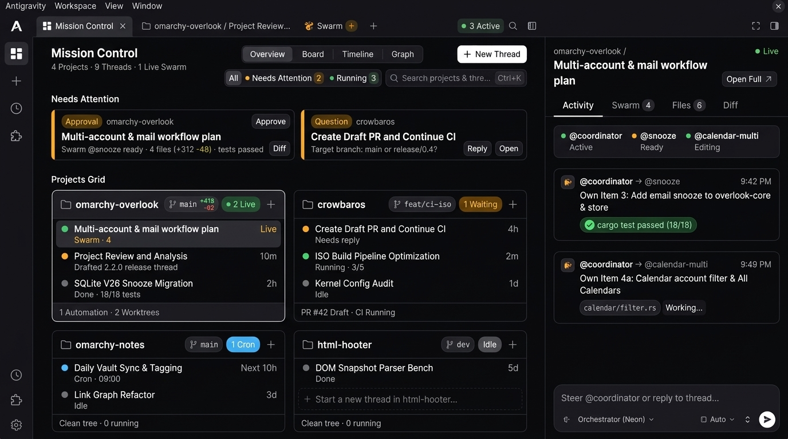

# Mission Control — Antigravity Project & Thread Dashboard Plugin

## 4 Key Upgrades Over the Left-Hand Sidebar

1. **Cross-Project "Needs Attention" Triage Strip**
   Surfaces blocked approvals, pending Swarm merges, and agent questions across every workspace (`omarchy-overlook`, `crowbaros`, etc.) in one horizontal priority strip with direct **Approve**, **Diff**, **Reply**, and **Open** actions—so nothing gets buried under collapsed sidebar folders.

2. **Rich Multi-Project Matrix (Git, Swarm & Cron Telemetry)**
   Collapses the text-heavy left sidebar into a 44px icon rail and promotes workspaces (`omarchy-overlook`, `crowbaros`, `omarchy-notes`, `html-hooter`) into a 2×2 grid. Each project card displays live branch/diff status, active worktrees, running threads, Swarm counts, and scheduled cron jobs (`09:00`) at a glance.

3. **Live Right-Hand Thread Peek & Quick-Reply Inspector**
   Clicking any thread opens a live inspector panel (`Activity`, `Swarm`, `Files`, `Diff`) alongside the grid—mirroring the native Swarm board cards (`@coordinator`, `@snooze`, `@calendar-multi`) with a docked bottom composer (`Orchestrator (Neon)`) so you can steer or reply without losing macro visibility.

4. **Dedicated Views & Fast Triage Filters**
   Switch between **Overview**, **Board**, **Timeline**, and **Graph** views, filter instantly by `Needs Attention`, `Running`, or search via `Ctrl+K`, and launch threads directly inside any project card.

---

## Mapping to Antigravity Plugin Primitives

This concept maps directly onto Antigravity's native **Plugin + Web UI Sidecar** model:

- **Plugin bundle**: `~/.gemini/config/plugins/mission-control/` with a `plugin.json` manifest (plus optional bundled skills/rules/MCP config).
- **Web UI sidecar**: `~/.gemini/config/plugins/mission-control/sidecars/<sidecar-id>/sidecar.json` (or referenced via `sidecars.json`) with `"has_web_ui": true` and a `ui_config.views` entry using `entrypoint: SIDECAR_UI_ENTRYPOINT_AUX_PANE` — the same auxiliary-pane UI extension architecture used by the built-in Swarm interface.
- **One-click chat navigation**: Once enabled and running, Antigravity surfaces it via a `sidecar://mission-control/<sidecar-id>/<view-path>` pill link directly in chat or workspace tabs.
